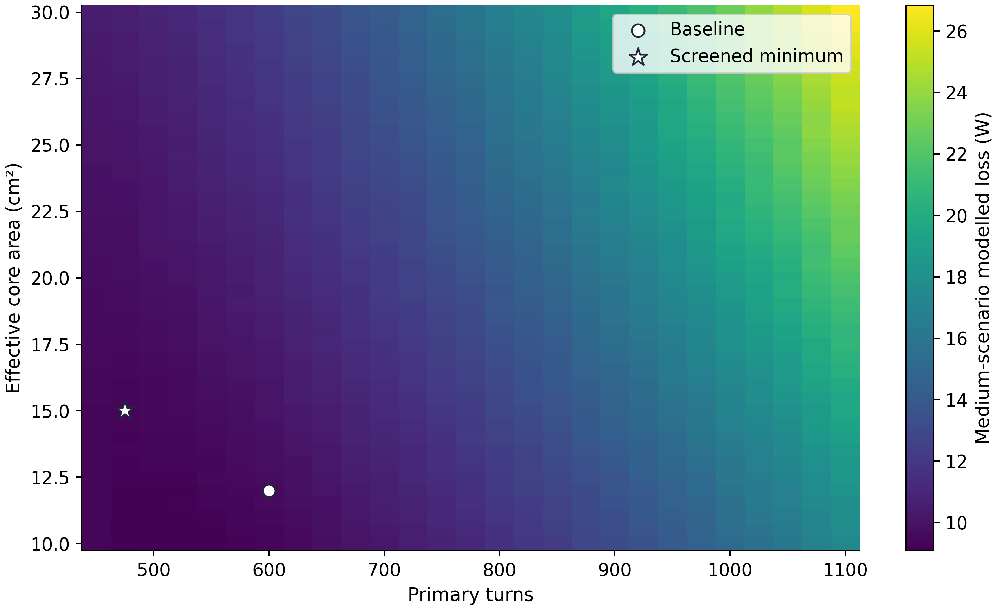

# Transformer Loss Trade-off Optimisation

*A Parametric Study of Copper, Eddy Current and Hysteresis Losses*

An independent electrical engineering study of how winding turns and core area affect the losses of a 100 VA single-phase transformer model. A Python model combines a layered winding geometry, a self-consistent load calculation and a constrained search of 1,107 designs. Under the **medium illustrative core-loss assumptions**, the lowest-loss passing point is **475:50 turns with 15.0 cm² of effective core area**. Its modelled loss is **9.342 W**, a **2.35% reduction** from the **9.567 W** same-scenario baseline. The core-loss coefficients are illustrative and uncalibrated.

[Read the engineering report (PDF)](report/Transformer_Loss_Optimisation_Report.pdf) · [Run the dashboard](#interactive-dashboard) · [Inspect the results](data/scenario_summary.csv)

Colour shows the entire grid. The star identifies the minimum among candidates that meet both electrical screens.

## Engineering research question

How can winding turns and effective core cross-sectional area minimise the combined copper, classical eddy current and hysteresis losses under simplified electrical constraints?

A design with more turns can reduce induction while increasing winding resistance. A larger core can reduce induction while adding steel mass and increasing the mean length of a turn. A joint grid search shows how those effects interact with voltage regulation.

## Mathematical model and constraints

The circuit supplies **230 V RMS at 50 Hz** and solves a self-consistent **100 VA output at unity power factor**. The secondary winding targets **24 V RMS**. The model combines primary and secondary winding losses from RMS current and resistance with classical eddy current and illustrative hysteresis losses evaluated at the loaded peak induction.

| Item | Definition |
| --- | --- |
| Baseline | 600:63 turns, 12.0 cm² effective steel area |
| Primary turns | 450–1,100 in increments of 25 |
| Effective core area | 10.0–30.0 cm² in increments of 0.5 cm² |
| Secondary turns | Nearest integer to primary turns × 24/230 |
| Screening | Nominal no-drop peak ≤1.50 T and loaded terminal voltage ≥22.0 V RMS |
| Ranking | Minimum summed modelled loss among the 251 passing grid points |

The flux screen uses the no-drop peak at nominal voltage. The core-loss terms use the internal induced voltage at the solved load. The terminal-voltage screen has no upper bound. Mass, winding fit and current density are diagnostics.

## Key results and sensitivity

| Coefficient scenario | Selected turns | Area (cm²) | Same-scenario baseline (W) | Minimum (W) |
| --- | ---: | ---: | ---: | ---: |
| Low | 450:47 | 15.5 | 8.518 | 7.785 |
| Medium | 475:50 | 15.0 | 9.567 | 9.342 |
| High | 600:63 | 12.0 | 10.664 | 10.664 |

The medium point is inside the grid and delivers a predicted 22.904 V RMS at 100 VA. It has longer mean turns but less total conductor length because it has fewer turns. Copper loss drops enough to offset an increase in core loss. The low scenario reaches the lower primary-turn boundary. The high scenario selects the original baseline. The differences show how the assumed coefficients affect the ranking.

## Limitations

The study uses uniform flux, simplified E–I geometry, constant copper temperature and an equivalent circuit that omits excitation and leakage. The objective excludes excess dynamic core losses, dielectric and stray losses, and AC winding corrections. The model describes a finite search at the stated resolution. It provides no experimentally measured efficiency, thermal rating or manufacturing validation. [Model assumptions and limitations](report/Methodology.md)

## Interactive dashboard

**Transformer Loss Explorer** has a project overview, a live loss calculator and an optimisation view. The live controls call the same Python candidate evaluator used to produce the grid. Change turns, area or the coefficient scenario, check the two screening results, then download the selected values or full grid.

From the repository root with Python 3.13:

~~~sh
python -m pip install -r requirements.txt
python -m streamlit run app/streamlit_app.py
~~~

[Dashboard source](app/streamlit_app.py) · [Deployment guide](app/DEPLOYMENT.md)

## Engineering report and reproducibility

- [Final engineering report (PDF)](report/Transformer_Loss_Optimisation_Report.pdf)
- [Methodology](report/Methodology.md) and [verification and reproducibility](report/Verification.md)
- [All candidates](data/all_1107_candidates.csv), [passing candidates](data/passing_candidates.csv) and [exact coefficients](data/illustrative_coefficients.csv)

~~~sh
python -m src.optimisation
python -m src.validate_final_report
python -m unittest discover -s tests -v
~~~

The model regenerates the tables and figures. An independent calculation checks the results and ranking. The Streamlit tests exercise the displayed values, screening and inputs, and compare the live evaluator with all 1,107 saved rows.

## References

- D. H. Staelin, *Electromagnetics and Applications*, chapter 3, MIT OpenCourseWare. [Transformer section](https://ocw.mit.edu/courses/6-013-electromagnetics-and-applications-spring-2009/be09fe40701d8ba037ddc18fea301449_MIT6_013S09_chap03.pdf)
- U.S. National Bureau of Standards, *Copper Wire Tables*, Handbook 100. [NIST archive](https://nvlpubs.nist.gov/nistpubs/Legacy/hb/nbshandbook100.pdf)
- G. Bertotti, “General properties of power losses in soft ferromagnetic materials,” *IEEE Transactions on Magnetics*, 1988. [DOI](https://doi.org/10.1109/20.43994)

The references explain the theory and copper reference values. The project specifies its own illustrative core-loss coefficients.
